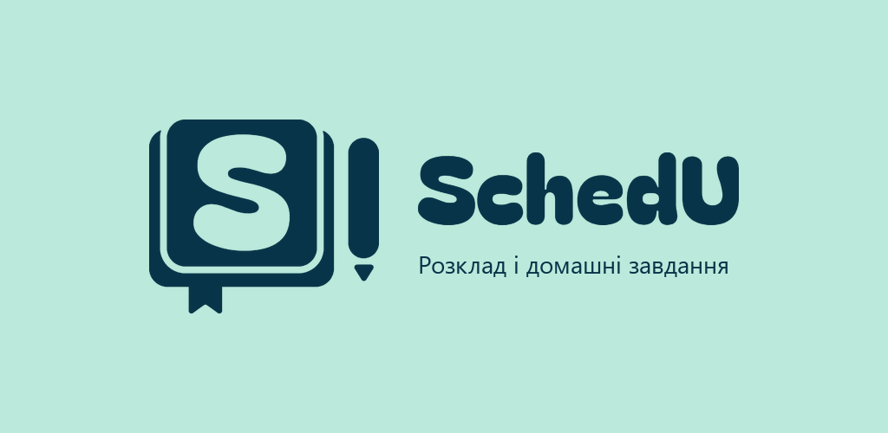
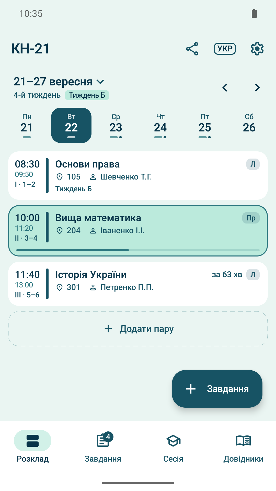
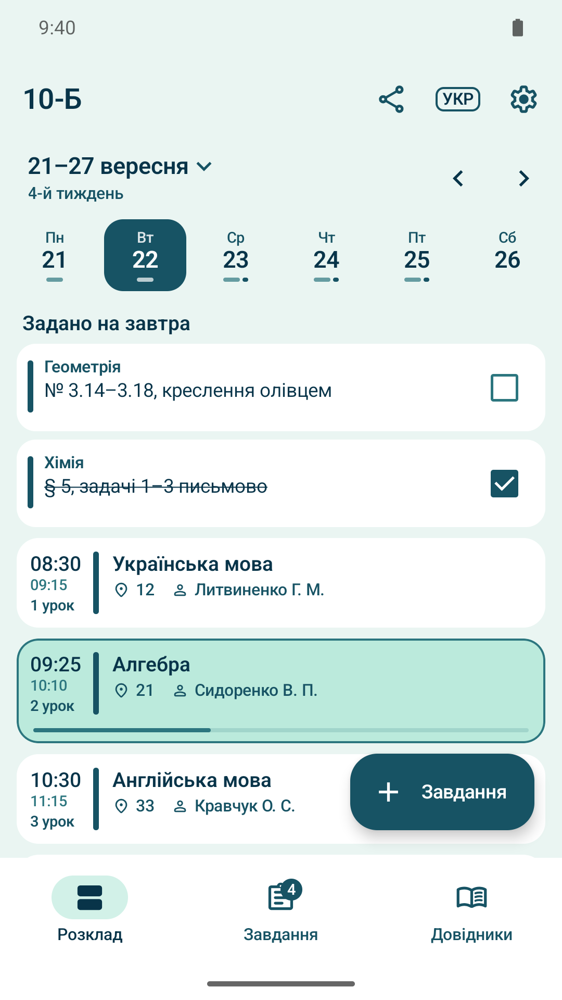
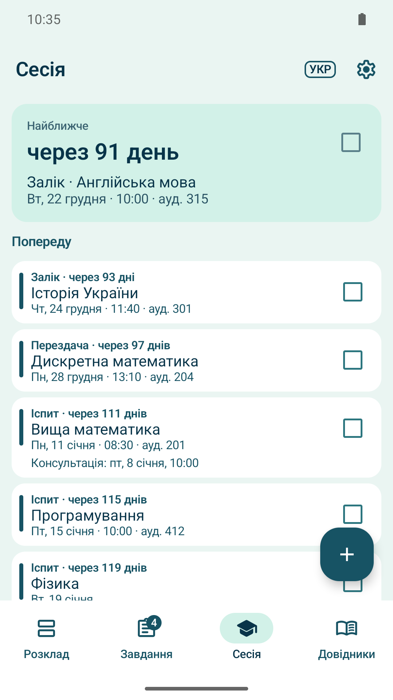
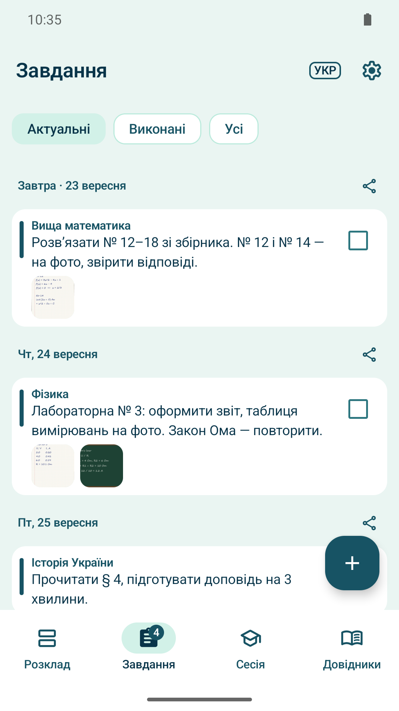
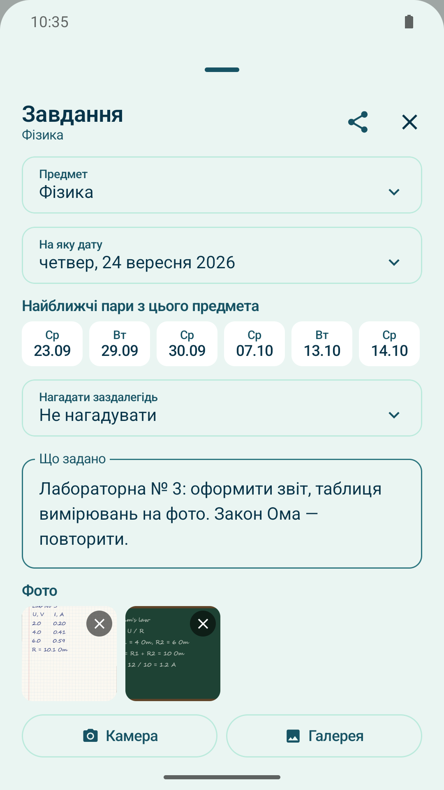
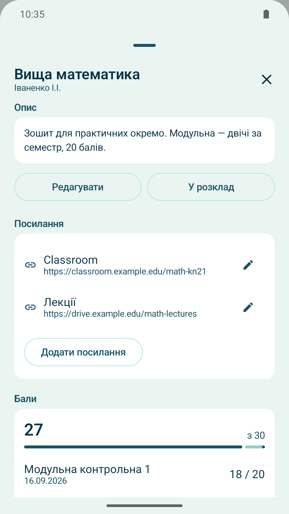
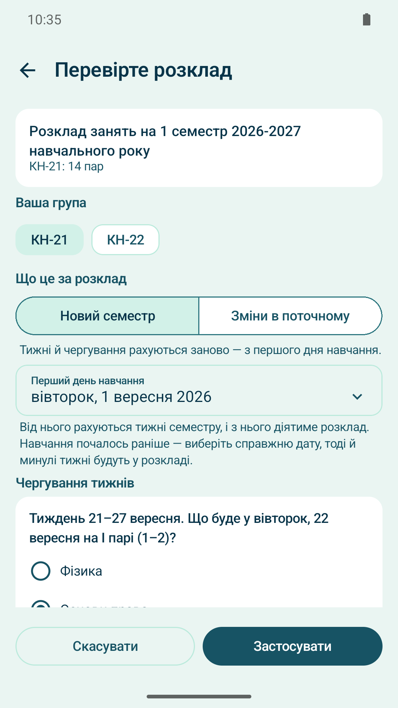
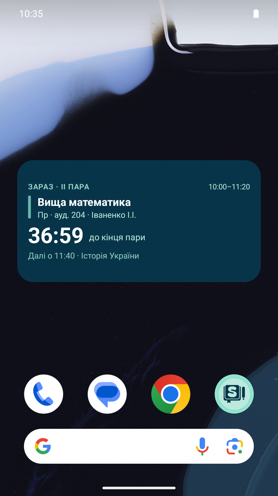

  

  

<b>English</b> · <a href="README.uk.md">Українська</a>

# SchedU: Timetable & Homework

An Android app for university students and high-school pupils: class timetable, homework with photos,
reminders and exam session tracking. Published on Google Play, version 1.9.0.

In Ukrainian universities the timetable usually arrives as a Word, Excel or PDF file from the dean's
office, and it changes during the semester. SchedU imports that file on the phone, works out groups,
subjects, rooms, teachers and class times, and keeps track of later changes without rewriting past weeks.

The app has no server, no accounts, no ads and no analytics. It does not even request the internet
permission: all data stays on the device.

## Screenshots

| Timetable | School mode | Exam session | Homework |
|:-:|:-:|:-:|:-:|
|  |  |  |  |
| **Homework photos** | **Subject and grades** | **Import check** | **Widget** |
|  |  |  |  |

## Features

- **Import from a file**: .docx, .xlsx, PDF with a text layer, and .ics from Google Calendar or any other
  calendar. Works with files from any institution that follows the common template, not just one university.
- **Manual grid** for timetables that came as a photo or a scan: the image stays on screen as a reference
  while you fill in "day × class".
- **Alternating weeks** (week A / week B) and changes that don't rewrite history: a one-off change for a
  single date, or a new version "from this date onward" with the change history visible on the class card.
- **Homework** with text and up to 10 photos per task, a "done" mark, and sharing to Telegram, Viber
  or WhatsApp.
- **Reminders**: in the evening, what's on tomorrow; in the morning, the first class and room; a few days
  ahead of a big deadline.
- **Exam session tab** with a countdown, and **grades per subject** with a target: "to get 75 you still need
  7 of the remaining 20".
- **Timetable for the whole group**: the class representative cleans up the import once and shares a file
  that opens in classmates' apps with no extra questions.
- **Teacher and subject directory** built from the timetable itself, with an archive by semester.
- **School mode** for high-school pupils: lessons, classes, bells and "homework for tomorrow".
- **Home-screen widget** counting down to the end of the current class or break.
- **Backup** of the timetable, tasks, photos and notes into a single file.
- **Interface in Ukrainian, English, German and Russian**, chosen inside the app.

## How it's built

| | |
|---|---|
| Language | Kotlin |
| UI | Jetpack Compose, Material 3, light and dark themes, phone and tablet layouts |
| Storage | Room (SQLite); 10 schema versions with migrations that keep users' data |
| Background work | AlarmManager for reminders and the widget, restored after reboot |
| PDF | PDFBox-Android |
| Min / target SDK | 26 / 36 |

Some of the more interesting parts:

- **File parsers without heavy libraries.** .docx and .xlsx are read directly as ZIP archives with XML
  inside, without Apache POI. Both feed one shared timetable grid model, so the cell rules (room,
  class type, teacher names) are written once.
- **Rebuilding a table from a PDF.** PDF has no tables, only words with coordinates and line segments.
  The parser restores rows and columns from the frame lines and places the words in cells.
- **Time-versioned timetable.** Each cell has versions valid "from date X onward" plus one-off exceptions.
  The classes for any given day are computed from them, so past weeks show what actually happened.
- **Tests.** 23 JVM test suites, including parsers run on sample files saved from Excel and Google
  Sheets, a real timetable file layout, and the backup format.
- **Release automation.** A Python script uploads the build, release notes and the store listing
  through the Google Play Developer API.
- **Localization** into four languages with a script that checks all string files stay in sync.

## Status

Published on Google Play since 2026 and in active development. The source code lives in a private
repository; I'm happy to walk through it on request.

Feedback about the app: dodatok.app.ua@gmail.com
