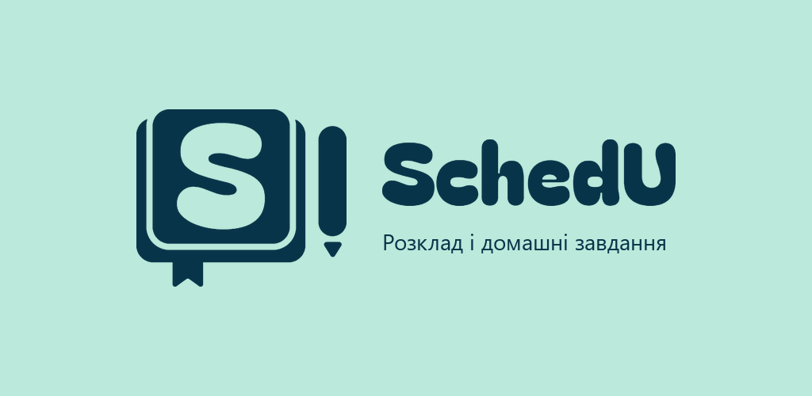
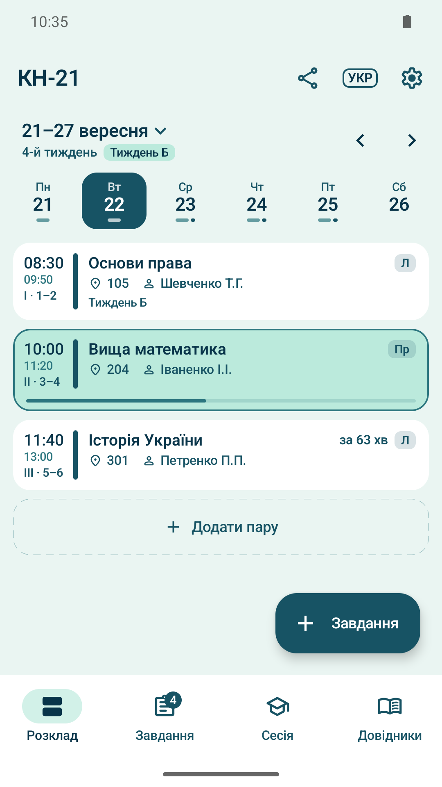
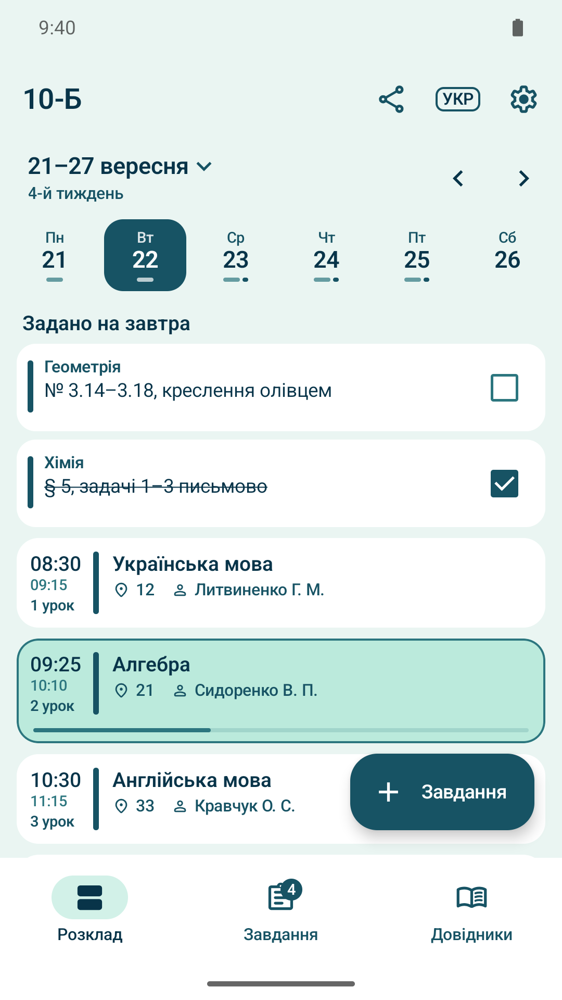
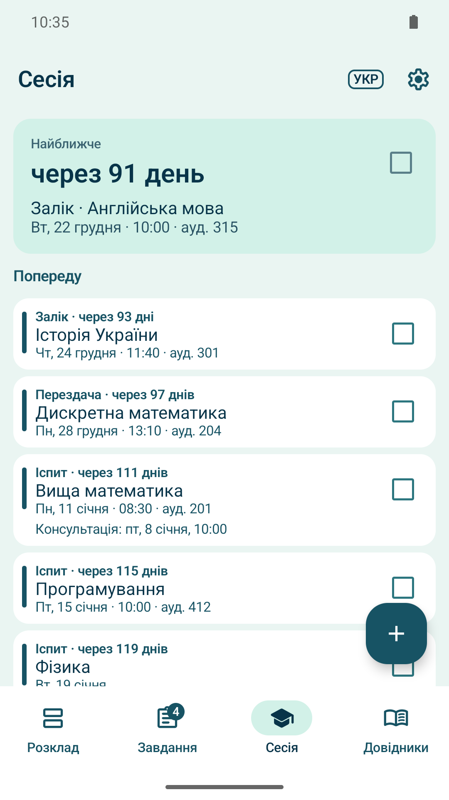
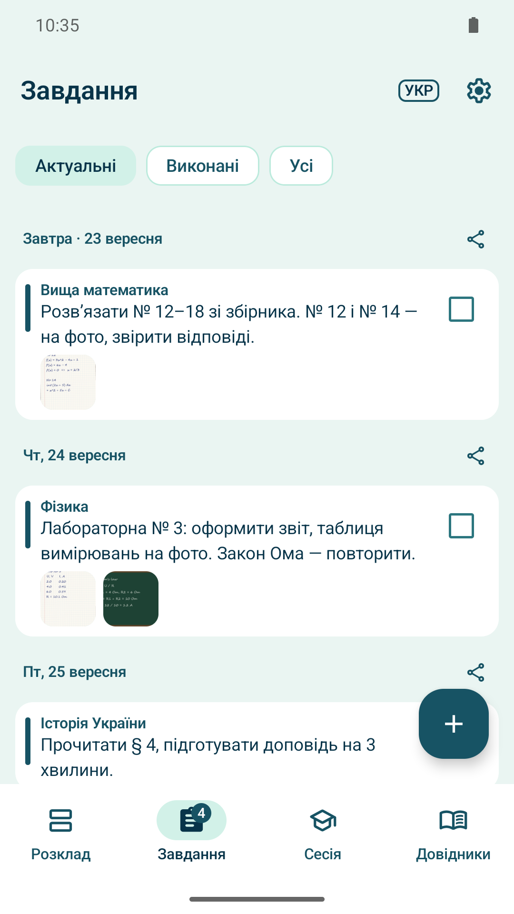
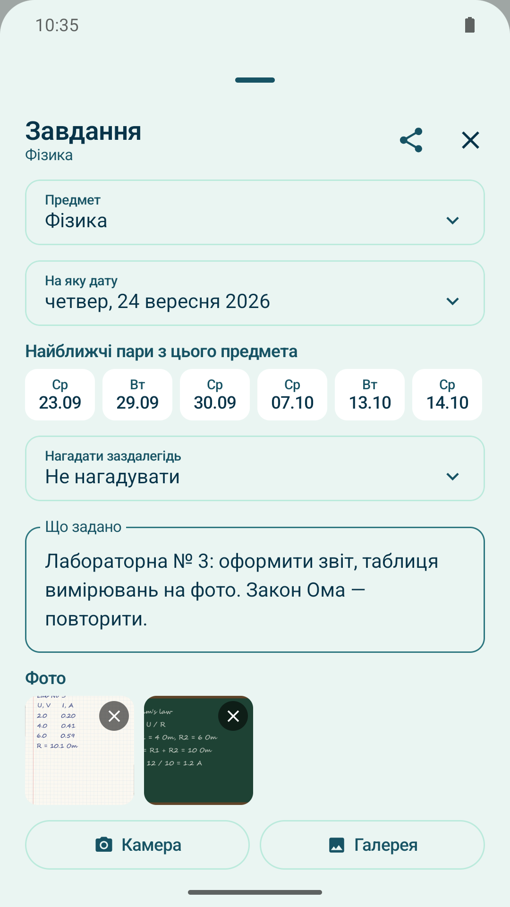
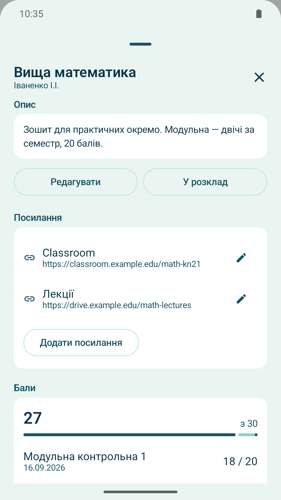
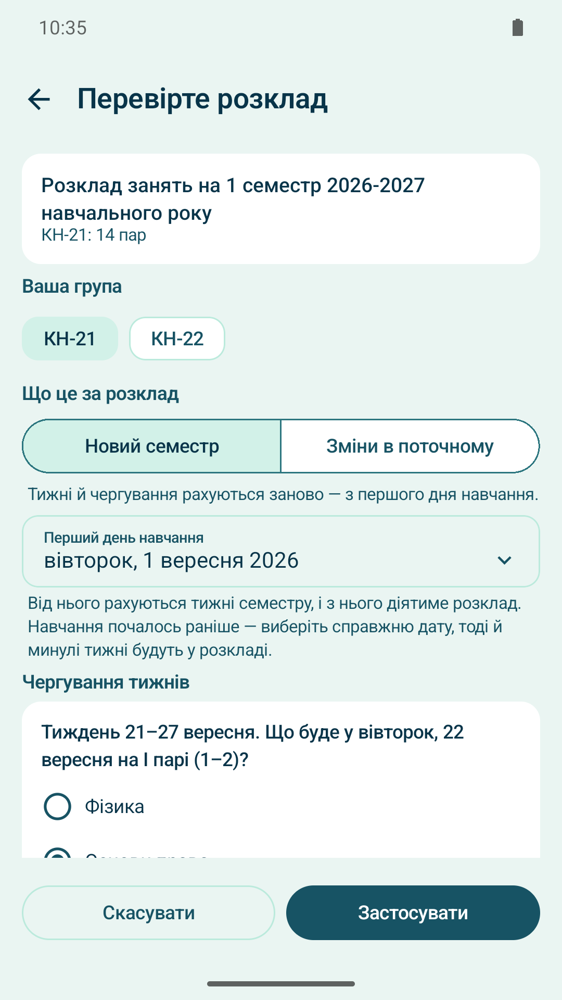
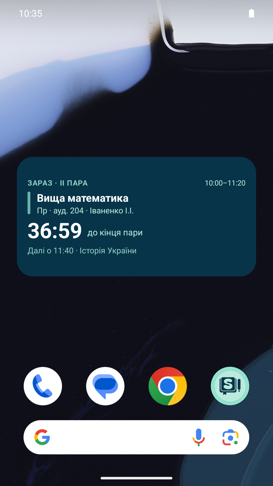

  

  

<a href="README.md">English</a> · <b>Українська</b>

# SchedU: розклад і домашні завдання

Android-застосунок для студентів і старшокласників: розклад пар, домашні завдання з фото,
нагадування й сесія. Опублікований у Google Play, версія 1.9.0.

В українських вишах розклад зазвичай приходить файлом Word, Excel чи PDF від деканату й змінюється
посеред семестру. SchedU імпортує цей файл просто на телефоні, сам визначає групи, предмети, аудиторії,
викладачів і час пар, а пізніші зміни веде так, що минулі тижні лишаються такими, якими були.

Немає сервера, акаунтів, реклами й аналітики. Застосунок навіть не просить дозволу на інтернет:
усі дані лишаються на пристрої.

## Скриншоти

| Розклад | Режим «Школа» | Сесія | Завдання |
|:-:|:-:|:-:|:-:|
|  |  |  |  |
| **Фото до завдання** | **Предмет і бали** | **Перевірка імпорту** | **Віджет** |
|  |  |  |  |

## Що вміє

- **Імпорт із файлу**: .docx, .xlsx, PDF із текстовим шаром і .ics з Google Календаря чи іншого календаря.
  Працює з файлами будь-якого закладу за типовим шаблоном, а не одного вишу.
- **Ручна сітка** для розкладу, що прийшов фото чи сканом: картинка лишається на екрані зразком,
  а нижче заповнюється «день × пара».
- **Тиждень А / Тиждень Б** і зміни без переписування минулого: разова заміна на одну дату або нова версія
  «з цієї дати й надалі» з історією змін у картці пари.
- **Домашні завдання** з текстом і до 10 фото, позначкою «виконано» й надсиланням у Telegram, Viber, WhatsApp.
- **Нагадування**: увечері що завтра, зранку перша пара й аудиторія, за кілька днів до великої здачі.
- **Сесія** з відліком днів і **бали за предметом** з метою: «щоб вийшло 75, треба ще 7 із 20 попереду».
- **Розклад для групи**: староста один раз виправляє імпорт і ділиться файлом, який в одногрупників
  відкривається без жодних запитань.
- **Довідник викладачів і предметів**, що складається з самого розкладу, з архівом за семестрами.
- **Режим «Школа»**: уроки, класи, дзвінки й «Задано на завтра».
- **Віджет** із відліком до кінця пари чи перерви.
- **Резервна копія** розкладу, завдань, фото й нотаток в один файл.
- **Інтерфейс українською, англійською, німецькою й російською**, мова вибирається в застосунку.

## Як зроблено

| | |
|---|---|
| Мова | Kotlin |
| Інтерфейс | Jetpack Compose, Material 3, світла й темна теми, макети для телефона й планшета |
| Дані | Room (SQLite); 10 версій схеми з міграціями, що зберігають дані користувачів |
| Фонова робота | AlarmManager для нагадувань і віджета, відновлення після перезавантаження |
| PDF | PDFBox-Android |
| Min / target SDK | 26 / 36 |

Цікаві частини:

- **Розбір файлів без важких бібліотек.** .docx і .xlsx читаються напряму як ZIP-архіви з XML, без
  Apache POI. Обидва читачі заповнюють одну спільну модель сітки розкладу, тож правила розбору клітинки
  (аудиторія, тип заняття, викладачі) написані один раз.
- **Таблиця з PDF.** У PDF немає таблиць, є лише слова з координатами й відрізки ліній. Парсер відновлює
  рядки й стовпці за лініями рамок і розкладає слова по клітинках.
- **Розклад із версіями в часі.** Кожна клітинка має версії «з дати X і надалі» та разові винятки.
  Пари на будь-який день обчислюються з них, тому минулі тижні показують те, що було насправді.
- **Тести.** 23 набори JVM-тестів, серед них парсери на зразках файлів, збережених з Excel і Google
  Таблиць, на макеті справжнього розкладу, і формат резервної копії.
- **Автоматизація випуску.** Скрипт на Python завантажує збірку, нотатки випуску й опис сторінки
  через Google Play Developer API.
- **Локалізація** на чотири мови й скрипт, що перевіряє узгодженість усіх файлів рядків.

## Стан

Опублікований у Google Play у 2026 році, розробка триває. Код у приватному репозиторії,
охоче покажу його на запит.

Відгуки про застосунок: dodatok.app.ua@gmail.com
